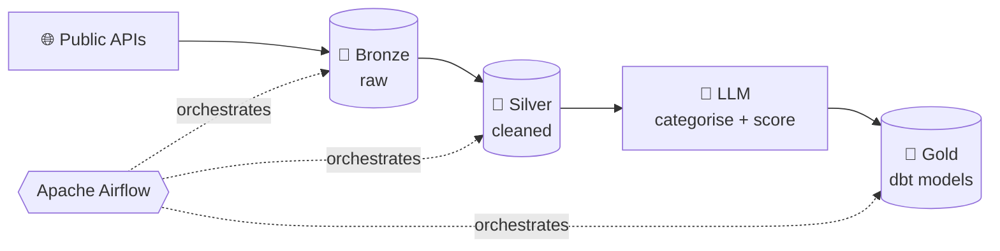

<!-- Header banner -->
<p align="center">
  
</p>

<p align="center">
  <a href="https://git.io/typing-svg">
    
  </a>
</p>

<p align="center">
  <a href="https://veriperi.github.io/"></a>
  <a href="https://www.linkedin.com/in/veriperi/"></a>
</p>

---

## 🧭 About Me

```yaml
role:        Data Analyst & Digital Marketing Associate  (Jul 2023 – present, ~3 yrs)
targeting:   Data Engineer | Junior Data Engineer | Associate Data Engineer
focus:       batch pipelines, medallion architecture, data modelling, orchestration
education:   B.E. Information Technology, University of Mumbai (2023) — CGPA 8.7
currently:   building a Spark → S3 → Snowflake market-data pipeline 🚧
```

- 🛠️ I build end-to-end pipelines: **ingest → clean → model → serve**, with tests and orchestration in between
- 📊 Three years as an analyst means I design tables with the *people who query them* in mind
- 🐛 I like the debugging part: Docker volumes, SQLAlchemy sessions, and database locks have all taught me something
- 🌱 Learning right now: **Apache Spark, AWS (S3), Snowflake**

---

## 🚀 Featured Projects

### 🧠 [Content Intelligence Pipeline](https://github.com/veriperi/content-intelligence-pipeline) &nbsp;`⭐ featured`

> Ingests content from public APIs, enriches it with LLM-assisted categorisation and quality scoring, and models it into analytics-ready tables.




**Engineering wins:** moved concurrent loading from SQLite to PostgreSQL to remove database-locking failures · fixed Docker volume persistence and SQLAlchemy session issues.

---

<table>
<tr>
<td width="50%" valign="top">

### 🌱 [WholeVegan Analytics](https://github.com/veriperi/wholevegan.co)
PostgreSQL analytical data layer on synthetic order data, served through an interactive Streamlit dashboard.


🔗 [**Live dashboard →**](https://wholevegan-analytics.streamlit.app)

</td>
<td width="50%" valign="top">

### 📈 [E-commerce KPI Dashboard](https://github.com/veriperi/ecommerce-kpi-dashboard)
KPI tracking for an e-commerce business: revenue, orders, conversion and customer metrics in one view.


</td>
</tr>
<tr>
<td colspan="2" valign="top">

### 📉 Nifty 50 Market Data Pipeline &nbsp;`🚧 in progress`
Minute-level Nifty 50 market data processed with Spark into an S3 data lake, warehoused in Snowflake, visualised in Tableau Public.

```
Kaggle (minute data) ──► Apache Spark ──► AWS S3 [Bronze → Silver → Gold] ──► Snowflake ──► Tableau Public
```


</td>
</tr>
</table>

---

## 🧰 Tech Stack

| Area | Tools |
|---|---|
| **Languages** |   |
| **Orchestration & Transformation** |    |
| **Databases & Warehouses** |    |
| **Cloud & DevOps** |    |
| **Analysis & BI** |    |

---

## 📊 GitHub Activity

<p align="center">
  
  
</p>

<p align="center">
  
</p>

---

<p align="center">
  <i>“In God we trust. All others must bring data.”</i> — W. Edwards Deming
</p>


